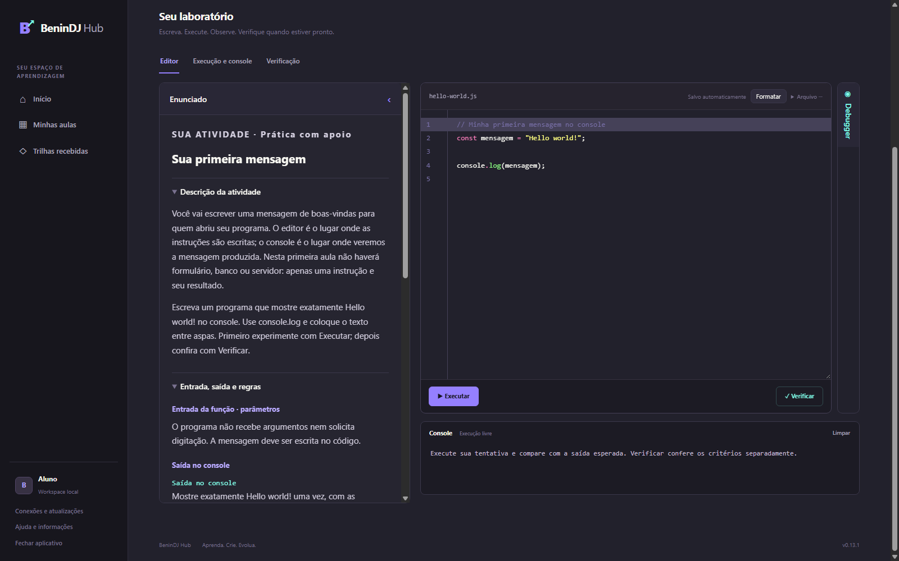
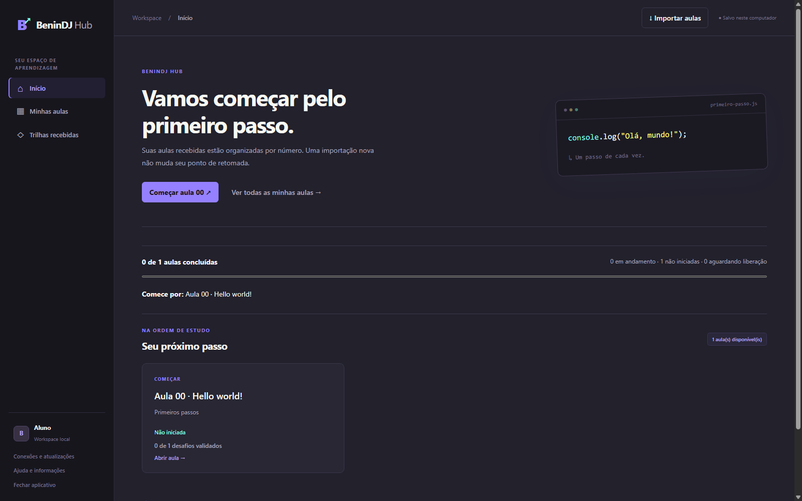

<div align="center">

# BeninDJ Hub · Aluno

**Aprenda programação escrevendo, executando e entendendo seu próprio código.**

Laboratório para Windows com aulas do seu professor, editor JavaScript, exercícios verificáveis e ferramentas de back-end no mesmo ambiente.

[Baixar para Windows](https://github.com/HDBenosx10/benindj-hub-app/releases/latest) · [Guia do laboratório](docs/ambientes/README.md) · [Reportar um problema](https://github.com/HDBenosx10/benindj-hub-app/issues)

</div>



## Um lugar para estudar e experimentar

No Hub, cada aula reúne explicação, exemplos e atividades. Você lê o contexto, escreve uma solução e acompanha o que o programa faz. **Executar** abre espaço para explorar seu raciocínio; **Verificar** confere os critérios da atividade e mostra o resultado dos testes.

| Recurso | Durante o estudo |
| --- | --- |
| Editor JavaScript | Destaque de sintaxe com paleta Dracula Pro, numeração de linhas e formatação com Prettier. |
| Enunciados por exercício | Contexto, parâmetros, entrada, saída esperada e regras ao lado do código. |
| Depuração | Breakpoints, variáveis, expressões observadas e execução passo a passo em um painel recolhível. |
| Bancada de back-end | SQLite, documentos JSON e mocks HTTP, conforme os recursos e permissões definidos na aula. |
| Progresso | Retomada da aula e da atividade em que você parou, com acompanhamento das verificações. |
| Fora do Hub | Exportação de projetos e ambiente para continuar praticando com ferramentas externas. |

## Comece em poucos passos

1. Abra a [última release](https://github.com/HDBenosx10/benindj-hub-app/releases/latest) e baixe o **instalador Aluno** para Windows x64. A opção portable também está disponível.
2. Instale e abra o BeninDJ Hub. O runtime necessário ao laboratório acompanha o aplicativo; você não precisa instalar Node ou SQLite para começar.
3. Experimente a **aula 0 — Hello world!**, a única aula incluída inicialmente.
4. Para receber o acervo do professor, use o convite fornecido por ele em **Conexões e atualizações**. Também é possível importar arquivos de uma ou várias aulas de uma vez.

> O convite é de uso único e o acesso fica associado à instalação ativada. Ao trocar de computador, peça ao professor a reemissão do acesso.



## Sua trilha acompanha a aula

Recebeu um planejamento? Consulte o [passo a passo para importar sua trilha](docs/receber-trilha.html). Na versão 0.13.1, o botão **Importar aulas** também aceita arquivos `.trilha-hub`.

O professor pode disponibilizar primeiro o **planejamento**: títulos, grupos e sequência das aulas. Você enxerga o percurso, mas o conteúdo de cada etapa só aparece depois da liberação. Receber uma trilha não libera automaticamente suas aulas.

Seus objetivos pessoais, como aprender JavaScript com foco em back-end, ajudam a identificar percursos compatíveis. A sequência de ensino é fornecida pelo professor. O runtime atual executa **JavaScript**; outras linguagens não estão disponíveis para execução nesta versão.

## Seus códigos continuam com você

Com Professor e Aluno na versão 0.14.2 ou superior, correções publicadas para a turma chegam pelo acervo conectado. Aulas já recebidas são atualizadas automaticamente; se a aula estiver aberta, um aviso permite salvar e aplicar a revisão. Não é preciso reinstalar o aplicativo a cada correção de conteúdo. [Veja o fluxo de atualização de aulas](docs/acervo-e-atualizacoes.md).

As respostas são salvas automaticamente no perfil do usuário do Windows, fora da pasta de instalação. Atualizar o aplicativo preserva esse perfil. Antes de trocar de computador, use os recursos de exportação de respostas; eles também são úteis como backup.

A edição instalada permite consultar, baixar e aplicar atualizações pelo aplicativo. Os pacotes de atualização são conferidos com assinatura e hash antes da instalação. Na edição portable, a atualização é feita substituindo o executável pelo novo download verificado.

Aluno e Professor podem coexistir na mesma máquina, com instalações, perfis e caches de atualização separados.

## Conheça as ferramentas

- [Editor, formatação e preservação de respostas](docs/editor-e-atualizacoes.md)
- [Depuração passo a passo](docs/depuracao.md)
- [Ambientes: banco, documentos e mocks HTTP](docs/ambientes/README.md)
- [Jornada e recursos das aulas](docs/jornada.md)
- [Acervo conectado e atualizações](docs/acervo-e-atualizacoes.md)

A interface utiliza uma paleta baseada no Dracula Pro do proprietário do projeto. Os prints são capturas reais do Hub, com um perfil demonstrativo, sem dados de alunos.

<details>
<summary><strong>Desenvolvimento e publicação</strong></summary>

Requisitos de desenvolvimento: Windows, Git e Node 24.13 ou superior.

```sh
npm ci
npm start
npm test
npm run build
```

O build inclui o runtime Node e npm usados pelas oficinas. Arquivos gerados, dados locais e chaves não pertencem ao repositório. O acervo privado e os gabaritos ficam no projeto Professor.

Tags `vX.Y.Z` acionam a esteira de release: testes, montagem, verificações do aplicativo e publicação dos pacotes de instalação e portable. O workflow **Gerar versão Windows** também permite uma execução manual. A publicação exige o Secret `HUB_UPDATE_PRIVATE_KEY`, compatível com a chave pública fixada no aplicativo. Nunca inclua a chave privada no Git.

</details>
